# Metis-data: measured results of the Metis paper

This repository holds the raw measurements (per-run logs and result CSVs)
behind the figures and numbers of the Metis paper. The code, the experiment
scripts, and the figure scripts are in
[sayakaaa00/Metis](https://github.com/sayakaaa00/Metis), which includes this
repository as the submodule `experiments/data/`. The experiment scripts in
`experiments/run/` write new runs in the same layout.

Only the runs that the paper's figures and numbers use are included. Log files
are copied unchanged from the working directory in which they were measured;
some are renamed to a common pattern. Result CSVs are filtered or concatenated
by row (header and values unchanged). `MANIFEST.tsv` lists the origin of every
directory and file.

## Figures of the paper

Each figure below is the version in the paper ([figures/pdf/](figures/pdf):
the PDFs included by the paper; `figures/figNN.png`: previews). For every
figure, the table gives the data in this repository and the script in
[Metis/experiments/figures](https://github.com/sayakaaa00/Metis/blob/Metis-ICDE/experiments/figures) that plots it
(`experiments/figures/make_figures.sh` runs them all).

The scripts plot the same data as the paper. The paper versions were redrawn
afterwards: one PDF per benchmark, a separate legend, and adjusted fonts and
labels. The data is unchanged, except that Fig. 7 adds two series. Fig. 9(b) is
identical to the script's output.

### Fig. 1: Throughput of Silo, Cicada, and ERMIA vs. Silo with the best active thread count (YCSB)

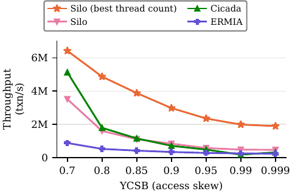

| | |
|---|---|
| Data | [ycsb/fixed](ycsb/fixed) (Silo, Cicada, ERMIA), [ycsb/oracle/skew_0.7-0.999](ycsb/oracle/skew_0.7-0.999) |
| Script | [`plot_intro_fixed_nometis.py`](https://github.com/sayakaaa00/Metis/blob/Metis-ICDE/experiments/figures/plot_intro_fixed_nometis.py) |
| Runs | Mean of 2 runs |

### Fig. 2: Throughput of Silo vs. active thread count at skew 0 (a) and 0.9 (b)

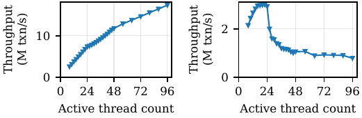

| | |
|---|---|
| Data | [ycsb/oracle/skew_0_0.5_0.9](ycsb/oracle/skew_0_0.5_0.9) |
| Script | [`plot_tps_vs_threads_lowhigh.py`](https://github.com/sayakaaa00/Metis/blob/Metis-ICDE/experiments/figures/plot_tps_vs_threads_lowhigh.py) |
| Runs | Mean of 2 runs |

### Fig. 3: Breakdown of worker-thread time of Silo vs. skew

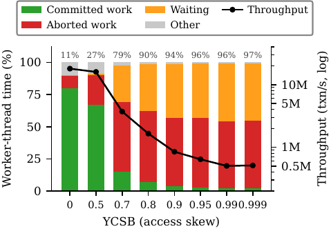

| | |
|---|---|
| Data | [ycsb/breakdown](ycsb/breakdown) |
| Script | [`plot_breakdown_vs_skew.py`](https://github.com/sayakaaa00/Metis/blob/Metis-ICDE/experiments/figures/plot_breakdown_vs_skew.py) |
| Runs | Time shares: sum of 2 runs; throughput and abort rate: mean of 2 runs |

### Fig. 4: Throughput of Silo under fixed backoff durations

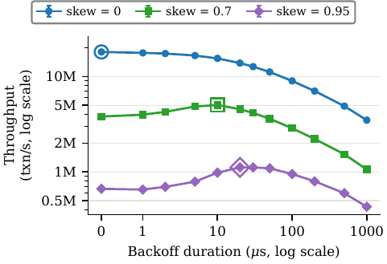

| | |
|---|---|
| Data | [ycsb/backoff_constant](ycsb/backoff_constant) |
| Script | [`plot_backoff_sensitivity.py`](https://github.com/sayakaaa00/Metis/blob/Metis-ICDE/experiments/figures/plot_backoff_sensitivity.py) |
| Runs | Mean of 2 runs |

### Fig. 5: Throughput of Silo vs. active thread count: (a) YCSB, (b) TPC-C

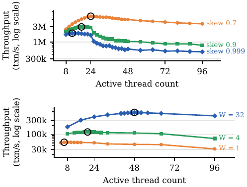

| | |
|---|---|
| Data | [ycsb/oracle/skew_0.7-0.999](ycsb/oracle/skew_0.7-0.999), [tpcc/oracle](tpcc/oracle) |
| Script | [`plot_motivation_tps_vs_threads.py`](https://github.com/sayakaaa00/Metis/blob/Metis-ICDE/experiments/figures/plot_motivation_tps_vs_threads.py) |
| Runs | Mean of 2 runs |

### Fig. 6: Overview of Metis

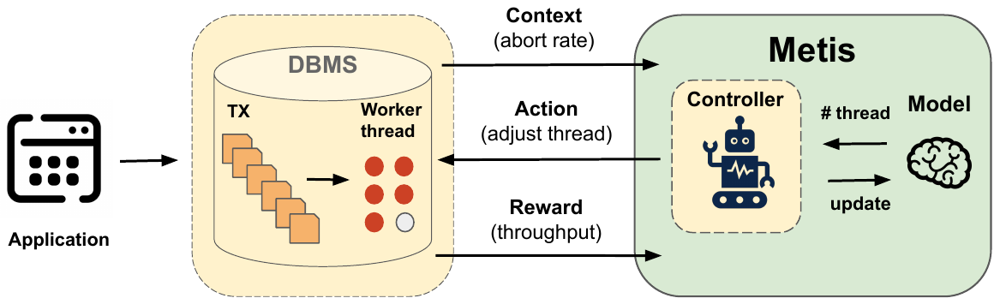

| | |
|---|---|
| Data | None (diagram) |
| Script | None |
| Runs | None |

### Fig. 7: Throughput across contention levels: (a) YCSB, (b) TPC-C

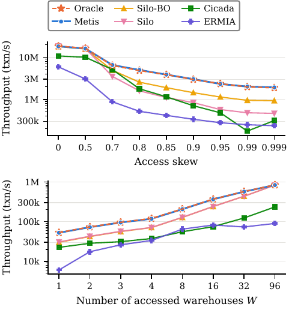

| | |
|---|---|
| Data | [ycsb/fixed](ycsb/fixed), [tpcc/fixed](tpcc/fixed) (`results.csv`: baselines; `results_metis.csv`: Metis), [tpcc/fixed/ermia_3s](tpcc/fixed/ermia_3s) (ERMIA on TPC-C), `*/oracle` |
| Script | [`plot_eval_static.py`](https://github.com/sayakaaa00/Metis/blob/Metis-ICDE/experiments/figures/plot_eval_static.py) |
| Runs | Mean of 2 runs |
| Note | The script draws Metis, Silo, Cicada, and ERMIA; the paper version also draws Oracle and Silo-BO (`silo_cbo_tuned`) from the same files. |

### Fig. 8: Active thread count of Metis and hill climbing in the first 150 control periods: (a) YCSB, (b) TPC-C

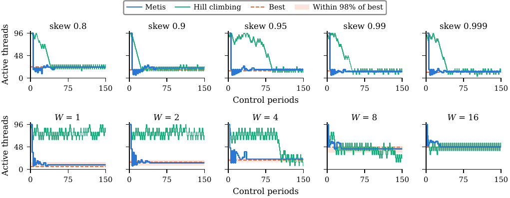

| | |
|---|---|
| Data | [ycsb/fixed/logs](ycsb/fixed/logs) (Metis), [ycsb/hill_climbing_10ms_log](ycsb/hill_climbing_10ms_log), [tpcc/fixed/logs](tpcc/fixed/logs) (`*.trace.log`) |
| Script | [`plot_eval_static_time.py`](https://github.com/sayakaaa00/Metis/blob/Metis-ICDE/experiments/figures/plot_eval_static_time.py) |
| Runs | Run 1 |

### Fig. 9: Throughput over time on dynamic workloads: (a) YCSB Y1, (b) TPC-C D1

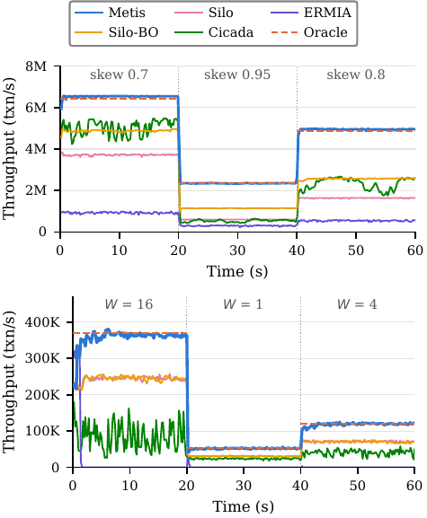

| | |
|---|---|
| Data | [ycsb/dynamic](ycsb/dynamic), [tpcc/dynamic](tpcc/dynamic) (`*.log`, `*.trace.log`) |
| Script | [`plot_eval_dynamic_tps.py`](https://github.com/sayakaaa00/Metis/blob/Metis-ICDE/experiments/figures/plot_eval_dynamic_tps.py), [`plot_eval_dynamic_tps_tpcc.py`](https://github.com/sayakaaa00/Metis/blob/Metis-ICDE/experiments/figures/plot_eval_dynamic_tps_tpcc.py) |
| Runs | Run 1, except Cicada in (a) (run 2; run 1 stops committing at 38 s) and Metis in (b) (run 2) |

### Fig. 10: Throughput per control period in the runs of Fig. 8: (a) YCSB, (b) TPC-C

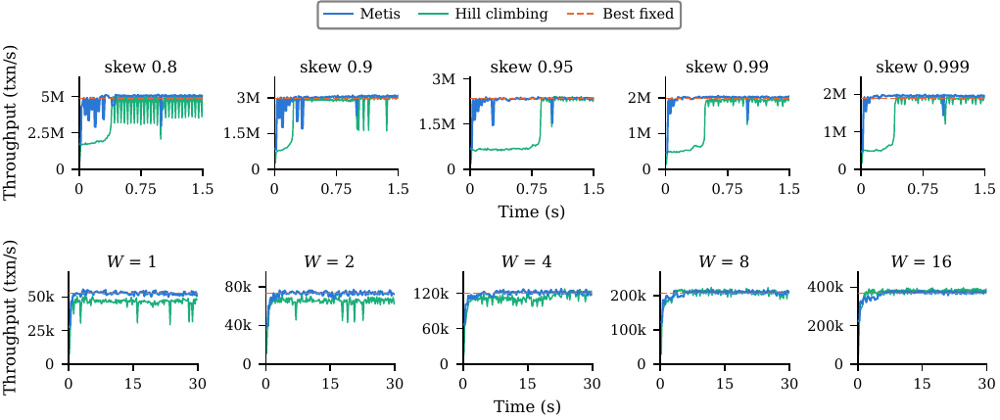

| | |
|---|---|
| Data | As Fig. 8 |
| Script | [`plot_eval_static_tps.py`](https://github.com/sayakaaa00/Metis/blob/Metis-ICDE/experiments/figures/plot_eval_static_tps.py) |
| Runs | Run 1 |

### Fig. 11: Active thread count on dynamic workloads: (a) YCSB Y4, (b) TPC-C D11

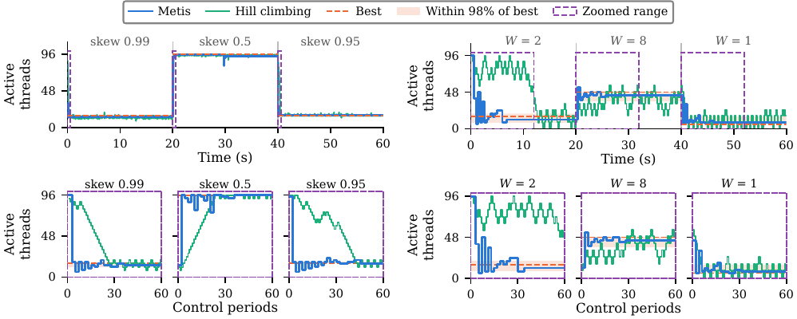

| | |
|---|---|
| Data | [ycsb/dynamic_hill_climbing](ycsb/dynamic_hill_climbing), [tpcc/dynamic_hill_climbing](tpcc/dynamic_hill_climbing) |
| Script | [`plot_eval_dynamic.py`](https://github.com/sayakaaa00/Metis/blob/Metis-ICDE/experiments/figures/plot_eval_dynamic.py) |
| Runs | Run 1 |

### Fig. 12: Throughput across contention levels in MySQL: (a) YCSB, (b) TPC-C

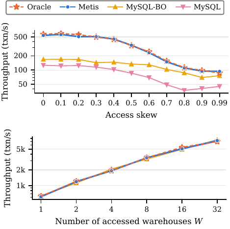

| | |
|---|---|
| Data | [Tatzhiro/MySQL-Metis-experiments](https://github.com/Tatzhiro/MySQL-Metis-experiments) (`results/`) |
| Script | In MySQL-Metis-experiments |
| Runs | See that repository |

### Fig. 13: Silo with the best fixed backoff vs. the best fixed active thread count: (a) YCSB, (b) TPC-C

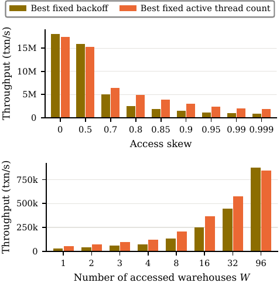

| | |
|---|---|
| Data | [ycsb/backoff_constant](ycsb/backoff_constant), [tpcc/backoff_constant](tpcc/backoff_constant), `*/oracle` |
| Script | [`plot_eval_backoff.py`](https://github.com/sayakaaa00/Metis/blob/Metis-ICDE/experiments/figures/plot_eval_backoff.py) |
| Runs | Mean of 2 runs |

## Machine

AWS, 2 × Intel Xeon Platinum 8375C (48 physical cores, 96 logical CPUs, 2 NUMA
nodes), 185 GiB of memory, Ubuntu 24.04, GCC 13. Every run starts 96 worker
threads, one per logical CPU, pinned physical-core first (socket 0, socket 1,
then the SMT siblings). TSC: 2900 clocks per µs.

## Workloads

- **TPC-C**: standard mix on 96 warehouses. The home warehouse is drawn from the
  first `W` warehouses (`W` = 1, 2, 3, 4, 8, 16, 32, 96). Runs last 30 s, and the
  control period is 200 ms.
- **YCSB**: 10,000 records, 10 operations per transaction, 50 % reads, Zipf skew 0 to 0.999.
  Runs last 10 s, and the control period is 10 ms.
- **Dynamic workloads** (60 s, two changes):

  | Name | Benchmark | Change | Paper use |
  |---|---|---|---|
  | `D1` | TPC-C | `W` 16 → 1 (20 s) → 4 (40 s) | Throughput over time |
  | `Y1` | YCSB | skew 0.7 → 0.95 → 0.8 | Throughput over time |
  | `D11` | TPC-C | `W` 2 → 8 → 1 | Comparison with hill climbing |
  | `Y4` | YCSB | skew 0.99 → 0.5 → 0.95 | Comparison with hill climbing |

## Method names in files

| Name in files | Name in the paper |
|---|---|
| `metis_v2`, `metis_v2_lowtrained` | Metis |
| `metis_v2_norephys` | Metis without re-measuring the physical-core count (`--metis_recheck_physical=false`), used for `Y4` |
| `hill_climbing` | Hill climbing on the active thread count (step 8 for TPC-C, 4 for YCSB) |
| `silo_cbo_tuned` | Silo-BO: Silo with the adaptive backoff of Cicada, tuned (see `*/backoff_adaptive_tuning`) |
| `silo_nobo` | Silo (all worker threads, no backoff) |
| `cicada`, `ermia` | Cicada and ERMIA with adaptive backoff |
| oracle | Silo with the best fixed active thread count (`*/oracle`) |

The flags in the logs use the names from the time of measurement
(`--metis_v2_*`, `--linucb_model_path`, `--tam_*`, log tag `[TAM sample]`); in
the Metis repository these are `--metis_*`, `--metis_model_path`, `--throttle_*`
(`--tam_update_period_us` is `--throttle_period_us`), and `[Throttle sample]`. Runs of the current scripts write `metis` instead of `metis_v2`.
Hill-climbing runs are named `hill_climbing` in the CSVs and file names; the log contents and
flags keep the controller's name at measurement time.

## Training and models (`min8`, `min6`)

Metis chooses among even active thread counts. Two training sets exist:

- `*/train/min8`, `*/models/min8`: candidates 8 to 96. Used for Metis in
  `tpcc/fixed`, `tpcc/dynamic` (D1), and `ycsb/dynamic` (Y1).
- `*/train/min6`, `*/models/min6`: candidates 6 to 96. Used for Metis in `ycsb/fixed`,
  `tpcc/dynamic_hill_climbing` (D11), and `ycsb/dynamic_hill_climbing` (Y4).
  YCSB `min6` is trained on all nine skews (0 to 0.999).

`train/<set>/state_<s>_run<r>.txt` holds the ridge-regression statistics of one
30-s training run. A model sums them over runs. `all.txt` pools every level, and
`loo_<s>.txt` leaves level `<s>` out (the static runs of `<s>` use it). The
models in the Metis repository (`experiments/models`) are these files with the
current header (`metis_model 1 ...` instead of `metis_v2_model 1 A 1 ...`).

## Layout

| Directory | Contents | Paper |
|---|---|---|
| `ycsb/oracle/skew_0.7-0.999` | Silo, throughput of every fixed active thread count (2 runs × 10 s) | Throughput vs. active thread count (Background), oracle |
| `ycsb/oracle/skew_0_0.5_0.9` | The same for skew 0, 0.5, and 0.9 | Introduction (skew 0 and 0.9), oracle at skew 0 and 0.5 |
| `tpcc/oracle/w<W>` | The same for TPC-C (coarse grid, then 2-step points around the best). `oracle_summary.json` equals the means of `w*/results.csv` | Background, oracle |
| `ycsb/breakdown` | Worker time on committed / aborted transactions and lock waiting vs. skew | Introduction, Background |
| `ycsb/backoff_constant`, `tpcc/backoff_constant` | Silo with a fixed backoff duration | Background (sensitivity), best fixed backoff (Evaluation) |
| `ycsb/backoff_exponential` | Silo with exponential backoff, initial duration swept | Background ("up to 86 % lower") |
| `*/backoff_adaptive_tuning` | Silo-BO for 4 update periods × 4 steps (`sweep.csv`) | Silo-BO setting, Background ("up to 48 % lower") |
| `*/fixed` | Static workloads: `results.csv` (Silo, Silo-BO, Cicada, ERMIA, hill climbing) and `results_metis.csv` | Static evaluation |
| `tpcc/fixed/ermia_3s` | ERMIA on TPC-C (3-s runs) | Static evaluation (TPC-C) |
| `ycsb/hill_climbing_10ms_log` | Hill climbing on YCSB with an active-thread sample every control period | Comparison with hill climbing (static) |
| `*/dynamic` | `D1` / `Y1`: Metis (`results_metis.csv`), Silo-BO, Silo, Cicada, ERMIA | Throughput over time |
| `*/dynamic_hill_climbing` | `D11` / `Y4`: Metis and hill climbing | Comparison with hill climbing (dynamic) |
| `*/train`, `*/models` | Training runs and models | Every Metis run |

Selected runs in the figures: run 1, except in the TPC-C D1 figure (Metis run 2) and in the YCSB Y1 figure (Cicada
run 2; run 1 stops committing at 38 s). Numbers in the text are means of the two runs unless stated otherwise.

## File formats

- `results.csv`: one row per run. Throughput (`tps`, committed transactions per second) and abort rate are averaged
  over the whole run. `mode_threads` / `mean_threads` summarize the active thread count of Metis and hill-climbing
  runs (empty for the other methods).
- `*.log`: standard output of the benchmark (flags and final statistics). `*.trace.log`: controller log, with one
  `[MetisV2]` (Metis) or hill-climbing line per decision (tagged with the controller's name at measurement time), `[TAM sample]` lines (active thread count at
  time `bench_s`), and in some runs `[TPS sample]` lines. `[TAM sample]` is written every 100 ms by default,
  every 200 ms in the TPC-C runs, and every 10 ms in `ycsb/hill_climbing_10ms_log` and
  `ycsb/dynamic_hill_climbing`. Cicada and ERMIA on TPC-C log `[TPC-C interval]` lines instead of `[TPS sample]`.
- `config.txt`: settings of the experiment script, and in some directories the binary path, its SHA-256, and
  the git commit of the code at the time of measurement.

The MySQL experiments are in
[Tatzhiro/MySQL-Metis-experiments](https://github.com/Tatzhiro/MySQL-Metis-experiments).
